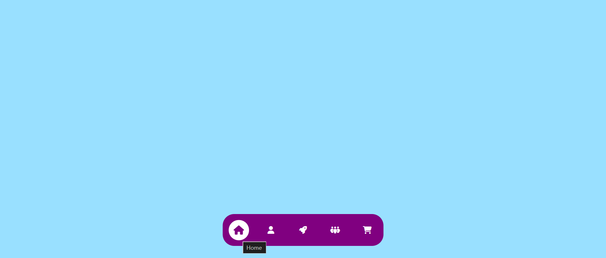

# 🌐 BARRA DE NAVEGACION INFERIOR

Una barra de navegación inferior flotante con iconos interactivos y efectos de transición fluidos al pasar el cursor (hover), construida con HTML5, CSS3 y Font Awesome.

[](https://coddy.tech)


---

## 📝 Sobre este proyecto
Este código fue creado como un ejercicio de práctica dentro del curso de **Coddy**.

* **Plataforma:** [Coddy.tech](https://coddy.tech)
* **Objetivo:** Practicar lógica de programación y desarrollo de software.

---

## 🚀 Características

- Diseño Flotante y Centrado: Posicionamiento absoluto y centrado en la parte inferior de la pantalla.

- Efectos Interactivos (Hover): Transiciones suaves de escala (scale), cambio de color y fondo circular al interactuar con cada opción.

- Iconografía Moderna: Integración con la librería Font Awesome v6.5.2.

- Layout Flexible: Diseñado mediante Flexbox para una distribución uniforme y adaptables de las opciones de navegación.

---

## 🛠️ Tecnologías Utilizadas

- HTML5: Estructura semántica del menú de navegación.

- CSS3: Estilos personalizados, posicionamiento, animaciones y transiciones.

- Font Awesome (v6.5.2 CDN): Iconos vectoriales para cada sección (Home, User, Dashboard, Chats, Cart).

---

## 📁 Estructura del Proyecto

```text
.
├── index.html   # Estructura principal de la navegación
├── styles.css   # Estilos CSS, posicionamiento y animación hover
└── README.md    # Documentación del proyecto
```

---

## 🔧 Instalación y Uso

Clona este repositorio:

```text
git clone: https://github.com/Maicol843/Barra-de-Navegacion-Inferior.git
```

Navega a la carpeta del proyecto:

```text
cd Barra-de-Navegacion-Inferior
```

Abre el proyecto:
Simplemente abre el archivo index.html en tu navegador preferido o utiliza la extensión Live Server en VS Code.

---

## 💡 Personalización

Puedes modificar el color principal de la barra o de las animaciones editando el archivo styles.css:

```text
/* Cambiar el fondo de la barra de navegación */
.navigation {
    background-color: purple; /* Cambia a tu color preferido */
}

/* Cambiar el efecto hover */
.navigation ul li:hover {
    color: purple;
    background-color: #fff;
    transform: scale(1.2);
}
```

---

<p align="center">
  
</p>

---

✨ Proyecto desarrollado como práctica de maquetación web y animaciones CSS.
<p align="left">
  
  <b>Proyecto de Práctica | Realizado en <a href="https://coddy.tech/journeys/html/bottom_navigation_bar__htmlcss_project">Coddy</a></b>
</p>
